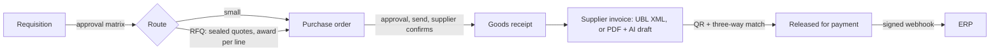
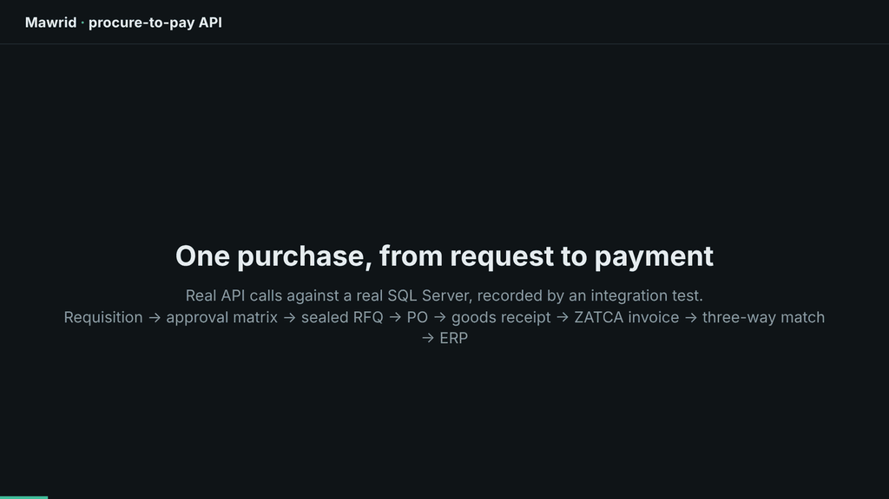

# Mawrid

A buyer-side procure-to-pay platform for companies in Saudi Arabia. It covers purchase requisitions, approval matrices, sealed RFQs, purchase orders, goods receipts, and supplier invoices. Every invoice is checked with a three-way match and a ZATCA QR check.

> Status: all milestones of the [delivery plan](docs/DESIGN.md#13-delivery-plan) (M1–M9) are built and tested. There is no frontend yet; the API is ready for one.



## Demo

One purchase from request to payment: real API calls against SQL Server, recorded from an integration test (2 minutes).




https://github.com/user-attachments/assets/f48cd85c-2af3-4452-9f7f-130bf768ca17


## What it does

- **Approvals:** a configurable matrix by amount and cost center, approver groups, delegation, and separation of duties.
- **Suppliers:** onboarding with documents, IBAN check, and a four-eyes rule for bank account changes.
- **Sourcing:** RFQs with sealed quotations (prices hidden until the deadline), amendments, and award per line.
- **Purchasing:** PO approval, sending, supplier acknowledgement, goods receipts with over-delivery tolerance, short close.
- **Payables:** ZATCA UBL invoices, QR (TLV) decoding, three-way match with tolerances, holds, overrides, automatic rechecks.
- **AI help:** PDF invoices are read into a draft with a confidence per value; a person always confirms.
- **Integration:** HMAC-signed ERP webhooks with retries and replay; email and SignalR notifications; Hangfire jobs.
- **Production basics:** multi-tenant data, audit trail, outbox, idempotency keys, ETags, rate limits, security headers, health checks, OpenTelemetry.

## Quick start

```bash
docker compose up --build            # API on :8080, SQL Server, Azurite, mock ERP on :8090
curl http://localhost:8080/health/ready
```

Demo users (password `Mawrid-Demo-2026`): `admin@acme.test`, `buyer@acme.test`, `approver@acme.test`, `requester@acme.test`, `receiver@acme.test`, `ap@acme.test`. The API description is at `http://localhost:8080/openapi/v1.json`.

Run the tests with `dotnet test Mawrid.slnx` (Docker must be running): about 370 tests, from domain rules to full HTTP flows against real SQL Server. See the [development guide](docs/DEVELOPMENT.md) for details.

## Docs

- [Design](docs/DESIGN.md): context, domain model, architecture, API, operations
- [Development guide](docs/DEVELOPMENT.md): run, test, migrate, configure, try webhooks and AI
- [Architecture decisions](docs/adr/README.md)
- [Glossary (EN/AR)](docs/GLOSSARY.md)
- [Design review of v1](docs/reviews/2026-11-design-review-v1.md)
- [Learning notes: NestJS → ASP.NET Core](docs/LEARNING.md)
- [Contributing and docs style](CONTRIBUTING.md)

## Tech

.NET 10 · ASP.NET Core · EF Core 10 · SQL Server 2022 · MediatR 12 · FluentValidation · ASP.NET Core Identity + JWT · Hangfire · SignalR · Microsoft.Extensions.Http.Resilience (Polly) · Data Protection · PdfPig · Serilog · OpenTelemetry · xUnit · Testcontainers · NetArchTest · Docker · GitHub Actions
