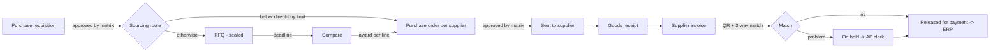
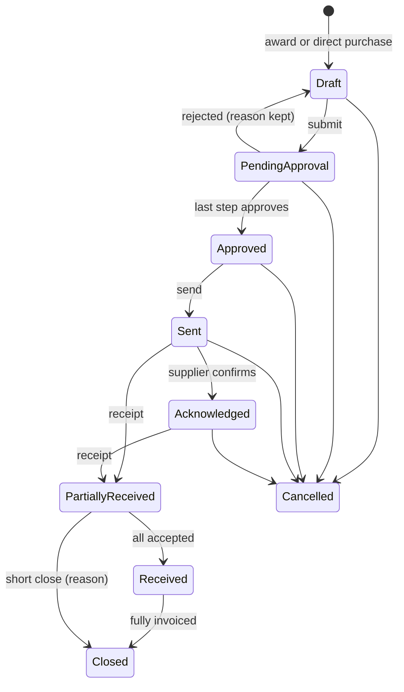
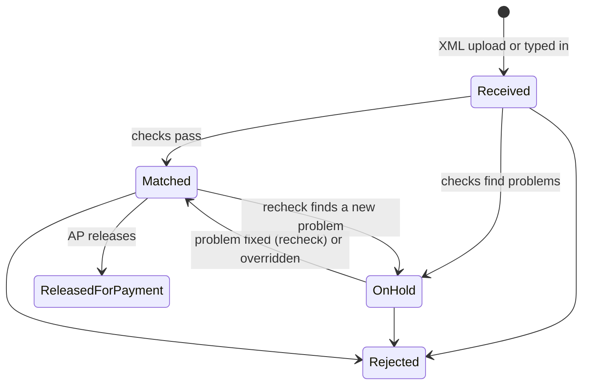
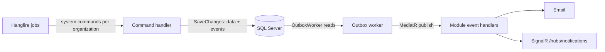
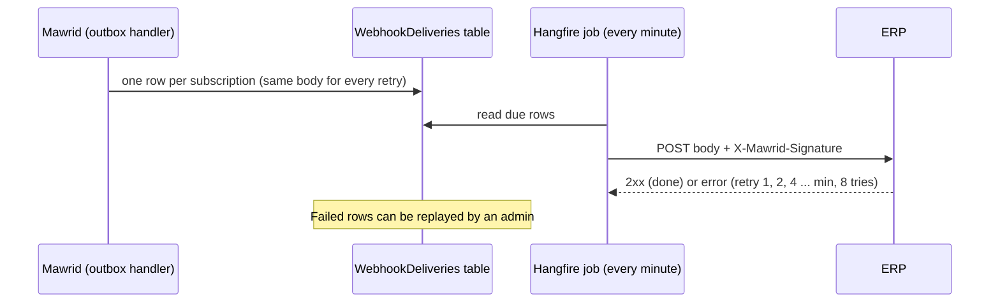
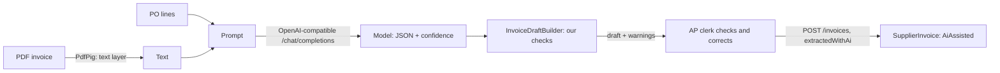

# Mawrid — Design (v2)

> v2 replaces v1 after the [design review](reviews/2026-11-design-review-v1.md). Important decisions are in the [ADRs](adr/README.md). Domain words are explained in the [glossary](GLOSSARY.md).

## 1. Context

Many mid-size companies in Saudi Arabia still buy things using email, WhatsApp and spreadsheets:

- An employee sends a request by email.
- Procurement emails three suppliers for prices.
- Quotes come back as PDFs, each in a different format.
- People approve in reply-all email threads.
- Accounts payable (AP) only learns about the order when the invoice arrives.

This causes five problems:

- **No control.** Whoever replies first approves the spend. There is no approval matrix and no separation of duties.
- **Unfair competition.** Buyers see prices as they arrive and can share them.
- **Slow process.** Nobody knows where a request is stuck.
- **Payment mistakes.** Invoices get paid without checking that the goods arrived, the price matches the PO, the VAT number is correct, or the invoice is not a duplicate.
- **Fraud.** Emails that say "our bank account changed" get paid.

Mawrid is a **buyer-side procure-to-pay platform**. Requesters, procurement, approvers, finance and suppliers all work on the same record, from the first request to an invoice that is ready to pay.

## 2. Goals, non-goals and success measures

### Goals (MVP)

1. Every purchase starts from an approved requisition. The right people approve it, based on a configurable matrix.
2. Suppliers compete with sealed quotations, and the buyer can award per line.
3. POs, goods receipts and invoices are linked. Every invoice is checked (three-way match and ZATCA QR) before it is released for payment.
4. Suppliers register themselves and keep their documents up to date. Bank changes are controlled.
5. Every action is audited. Approved POs and invoices can be sent to the customer's ERP.

### Non-goals (for now)

- Payments, or creating invoices for suppliers (see [ADR-0006](adr/0006-buyer-side-invoice-ingestion.md)).
- Budget control. We store the cost center, but checking budgets comes later.
- Contracts, catalogs and punch-out.
- Multiple currencies (SAR only).
- A supplier network shared between organizations.
- A frontend. The API is built so a React client can be added later.

### Success measures (for a pilot customer)

| Measure | Target |
|---|---|
| PR → PO time | Median under 5 working days |
| Spend that goes through approved PRs | Above 90% |
| Invoices matched with no manual work | Above 70% |
| Duplicate or wrong-VAT invoices that get paid | Zero |

## 3. Users

| Persona | Role(s) | What they need |
|---|---|---|
| Requester (any employee) | `Requester` | Create a PR quickly and track it |
| Cost center manager, director, CFO | `Approver` (scoped by policy) | Approve or reject with full context; delegate when away |
| Procurement officer | `Buyer` | Turn PRs into RFQs or POs, compare sealed quotes, award, follow deliveries |
| Storekeeper / receiver | `Receiver` | Record what actually arrived |
| AP clerk | `ApClerk` | Fix invoices on hold; release matched invoices |
| Procurement admin | `Admin` | Manage users, approval policies, tolerances and supplier checks |
| Supplier contact | `SupplierUser` | Register, keep documents valid, answer RFQs, accept POs, send invoices |

## 4. Assumptions and non-functional requirements

### Volume (per organization, for a company of about 500 employees)

| Item | Volume |
|---|---|
| Active suppliers | 1,500 |
| PRs | 400 per month |
| RFQs | 150 per month (about 5 suppliers invited to each) |
| POs | 1,000 per month |
| Supplier invoices | 1,500 per month (about 40% arrive in the last 5 days of the month) |
| Attachments | About 5 MB on average, 25 MB maximum per file |

The load is small and transactional. Correctness and audit matter much more than speed.

### Non-functional requirements (NFRs)

| Area | Target |
|---|---|
| Latency | p95 below 300 ms for reads and below 600 ms for commands (excluding file upload and AI extraction) |
| Availability | 99.5% per month |
| Data safety | RPO 15 minutes, RTO 4 hours (managed SQL with point-in-time restore) |
| Consistency | Strong inside one command (one transaction). Side effects arrive a few seconds later, through the outbox |
| Security | TLS everywhere; tests prove tenant isolation; OWASP ASVS Level 2 as the checklist |
| Data retention | Business records are never hard-deleted. Financial records follow ZATCA record-keeping rules. Personal data follows the PDPL |
| Localization | Arabic and English for all user messages; business times in `Asia/Riyadh`; Saudi work week |
| Support | Every request has a correlation ID. Every state change has an audit row (who, when, what changed) |

## 5. End-to-end flow



## 6. Modules and domain model

The app is a modular monolith ([ADR-0001](adr/0001-modular-monolith-clean-architecture.md)). Every entity has an `OrganizationId` ([ADR-0003](adr/0003-tenant-ready-from-day-one.md)). Every aggregate root has a `RowVersion`.

### 6.1 Identity

- Entities: `Organization`, `User`, `CostCenter`.
- A role can be limited to a **scope**. For example, a user can be `Approver` only for cost center `IT-001`.
- A supplier user belongs to exactly one `Supplier`.

### 6.2 Suppliers

**`Supplier`** (aggregate)

- Fields: `NameAr`, `NameEn`, `VatNumber`, `CrNumber`, `Status`, `Contacts`, `Documents`, `BankAccount`.
- Status: `Registered → UnderReview → Approved ⇄ Blocked`, or `Rejected`.

| Rule | Detail |
|---|---|
| VAT number | 15 digits, starts and ends with `3`, unique per organization |
| CR number | 10 digits |
| Documents needed to approve | CR certificate, VAT certificate, bank letter. Each has an `ExpiresOn` date |
| Required document expired | The supplier cannot win new awards. Open POs continue. A daily job warns 30, 14 and 3 days before expiry |
| IBAN | `SA` + 22 characters, valid mod-97 checksum |
| Bank account change | The new `BankAccount` starts as `PendingVerification`. This supplier's invoices cannot be released for payment until a second Admin verifies it (four-eyes rule). The old account stays in history |

### 6.3 Approvals (shared engine)

PRs and POs use this engine. Invoices that exceed tolerance will use it later.

**`ApprovalPolicy`**

- Has a document type (PR or PO) and a list of **rules** in order.
- A rule matches on an amount band (total including VAT), and optionally on cost center or category.
- A matching rule gives a list of **steps** in order. Each step says which role approves and for which scope. For example: "Approver of the PR's cost center", "Finance Director", "CFO".

Example default matrix:

| Total incl. VAT (SAR) | Steps |
|---|---|
| ≤ 10,000 | Cost center manager |
| ≤ 100,000 | Cost center manager → Department director |
| > 100,000 | Cost center manager → Department director → CFO |

**`ApprovalRequest`** (aggregate)

- Created when a document is submitted. It takes a **copy** of the matching policy, so later policy changes do not affect approvals already in progress.
- Steps run **in order**. A rejection at any step ends the request. Any one eligible approver can decide a step.
- **Separation of duties:** the requester or creator of the document can never approve it, even if they have the role.
- **Delegation:** an `ApprovalDelegation(from, to, validFrom, validTo)` lets another user approve. The decision is saved as "by X on behalf of Y".
- **Concurrency:** if two approvers act on the same step at the same time, one succeeds and the other gets `412`.

### 6.4 Requisitions

**`PurchaseRequisition`** (aggregate)

- Fields: requester, cost center, reason, needed-by date, and lines (description, quantity, unit, estimated unit price, optional preferred supplier).
- Status: `Draft → PendingApproval → Approved → InSourcing → Ordered`, or `Rejected` / `Cancelled`.
- After approval, the Buyer chooses the **sourcing route**:
  - **Direct PO** — allowed when the estimated total is at or below `DirectPurchaseLimit` (default 5,000 SAR).
  - **RFQ** — used otherwise. At least `MinimumSuppliersPerRfq` suppliers must be invited (default 3). Inviting fewer needs a written **single-source reason**.

### 6.5 Sourcing

**`Rfq`** (aggregate)

- Created from one or more approved PR lines.
- Has items, invited suppliers, a deadline, terms and attachments.
- Status: `Draft → Published → Closed → Awarded`, or `Cancelled`.

| Rule | Detail |
|---|---|
| Publish | Needs at least one item. All invited suppliers must be approved and allowed to win awards. The deadline must be at least `MinimumRfqWindow` away (default 3 working days) |
| Sealed | Prices are hidden until close ([ADR-0007](adr/0007-sealed-quotations.md)) |
| Deadline | When `IClock.UtcNow >= Deadline`, submissions are closed. This is **checked in the domain**. The close job only updates the status and sends notifications |
| Change after publish | Suppliers who already submitted must confirm again. The deadline moves if needed, to keep the minimum window |

**`Quotation`** (aggregate)

- One quotation per `(RfqId, SupplierId)`, enforced by a unique index.
- Has lines (unit price, VAT category, lead time in days), a valid-until date and attachments.
- The supplier can change it until the deadline. Every version is saved, and only the latest one counts.

**Award**

- Done **per RFQ line**: for each RFQ line, the buyer picks one quotation line. Partial award is allowed; lines with no award go back to the PR as not sourced.
- Choosing a supplier that is not the cheapest needs a written reason.
- After the award:
  - the RFQ becomes `Awarded`;
  - a **draft PO is created for each winning supplier**;
  - suppliers who did not win are notified through the outbox.

### 6.6 Purchasing

**`PurchaseOrder`** (aggregate)

- Fields: supplier, lines (from the award or directly from the PR), delivery address, payment terms, totals.
- A PO comes from an RFQ award, or from a small requisition routed to direct purchase.



| Rule | Detail |
|---|---|
| Submit | Starts an approval request using the PO policy, for the total including VAT |
| Supplier | Must still be allowed to win awards when the PO is submitted |
| Direct purchase | Every requisition line gets a price; the real net total must stay within the direct purchase limit |
| Cancel | Only before anything is received. A pending approval is cancelled too |
| Close | When fully received **and** fully invoiced, or "short closed" with a reason when partly received |
| Receive | Receiver role only. The buyer who created the PO cannot receive it (segregation of duties) |
| Visibility | A supplier sees its own POs only after they are sent, without internal fields |
| Concurrency | Every state change accepts `If-Match`; a stale version gives `412` |
| Totals | Calculated in the domain, line by line: VAT per line, rounded half away from zero to 2 decimals |

**Goods receipt** (part of the PO aggregate)

- Each line has the quantity accepted, the quantity rejected, and a reason for any rejection.
- The total accepted quantity can never be more than the ordered quantity plus the over-delivery tolerance (default 0%).

### 6.7 Payables

**`SupplierInvoice`** (aggregate)

- Fields: supplier invoice number, issue date, PO, lines (each refers to one PO line), totals as the supplier stated them, source files (XML/PDF), QR text, holds.
- **Intake:** the supplier uploads a ZATCA UBL 2.1 XML file (the main path), or an AP clerk types in an invoice that came only as a PDF. The checks run at once.
- **Intake refuses** (no invoice is created): an unreadable file, a seller VAT number in the XML that is not the sender's, a PO that was not sent to this supplier, and a duplicate number. **Duplicate check:** unique `(OrganizationId, SupplierId, SupplierInvoiceNumber)`.



- **Checks** ([ADR-0006](adr/0006-buyer-side-invoice-ingestion.md)) produce holds `{ Code, LineNumber?, Expected, Actual }`. Differences of up to 0.01 SAR are rounding.

| Code | Fails when | Override |
|---|---|---|
| `qr.missing` / `qr.malformed` | There is no QR, or the TLV is invalid | AP clerk, with a reason |
| `qr.vat_mismatch` | The QR seller VAT number is not the supplier's VAT number | AP clerk |
| `qr.total_mismatch` | The QR totals do not match the invoice totals | AP clerk |
| `line.amount` | Line net ≠ quantity × unit price | AP clerk |
| `vat.calculation` | Line VAT ≠ line net × rate (rate by issue date) | AP clerk |
| `totals.mismatch` | Invoice totals ≠ sum of the lines | AP clerk |
| `match.price` | The extra cost on a line is more than the price tolerance: 2% of the PO line, and at most 500 SAR | **Admin only** |
| `match.quantity` | This invoice plus the supplier's other non-rejected invoices for the line are more than the accepted quantity | No: receive the goods |
| `match.line_unknown` | The invoice refers to a line the PO does not have | No: reject |
| `supplier.bank_unverified` | The supplier's new bank account waits for verification | No: verify the account |

- **Rechecks happen by themselves** when the cause may be fixed: when goods are received for the PO, or when the supplier's bank account is verified. An override is kept if exactly the same problem comes back.
- **Release** records the invoiced quantities on the PO in the same transaction, and sends `supplier_invoice.released` to the ERP. A typed-in invoice needs a second person to release it.
- **The supplier sees** `InReview`, `ReleasedForPayment` or `Rejected` with the reason, not the internal hold details.
- **VAT rates have start dates** (`VatRates`), so old documents still calculate correctly.
- Not yet: credit notes, and approvals for overrides (today an admin override is the control).

### 6.8 Money and time

- `Money(decimal Amount, string Currency)`. Unit prices are stored as `decimal(19,4)` and totals as `decimal(19,2)`. Never use `double` for money.
- All times are stored in UTC. Business deadlines and SLAs are checked in `Asia/Riyadh`, with a work-week calendar (Sunday to Thursday, holidays configurable).

## 7. Architecture

### 7.1 Layers and modules

```
src/
  Mawrid.Domain/          {Module}/  entities, value objects, domain events, errors
  Mawrid.Application/     {Module}/  commands, queries, validators, module interfaces
                          Common/    behaviors, Result, ICurrentUser, IClock, IAppDbContext
  Mawrid.Infrastructure/  {Module}/  EF configurations, integrations
                          Common/    AppDbContext, interceptors, outbox worker, storage, auth
  Mawrid.Api/             {Module}/  endpoints
                          Common/    ProblemDetails, idempotency, localization, OpenAPI
tests/
  Mawrid.Domain.Tests/  Mawrid.Application.Tests/  Mawrid.Api.Tests/  Mawrid.Architecture.Tests/
```

### 7.2 Command pipeline

Every command goes through the same MediatR behaviors, in this order:

1. **Logging and tracing** — start a trace and log the command name and correlation ID.
2. **Validation** — run FluentValidation. If it fails, return `400` with field errors.
3. **Idempotency** — if the request has an `Idempotency-Key` we have seen, return the saved response.
4. **Unit of work** — run the handler, then `SaveChanges`. In the same transaction, interceptors:
   - set the tenant and audit fields;
   - write audit rows from domain events;
   - write outbox rows.
5. **Result mapping** — turn `Result<T>` into an HTTP status and a `ProblemDetails` with a stable `code`.

Queries skip steps 3 and 4. They read with `AsNoTracking()` and map straight to DTOs.

### 7.3 Side effects

Side effects use the transactional outbox ([ADR-0004](adr/0004-transactional-outbox.md)):



- A `BackgroundService` reads the outbox and publishes each event to the module handlers.
- **Notifications:** each module has handlers that pick the recipients (for example the supplier's users when a PO is sent). `INotificationSender` sends through every channel: SignalR and email (an interface; development writes to the log). A failing channel is logged and skipped.
- **Hangfire** runs recurring jobs: closing RFQs, document expiry warnings, approval reminders and clean-up. Each job sends a system command once per organization, so the tenant filter works as in a request.
- **Integration events** carry facts between modules without sharing entities ([ADR-0010](adr/0010-integration-events-between-modules.md)): for example a goods receipt makes Payables check held invoices again.
- **ERP webhooks** are queued by an outbox handler and sent by a Hangfire job (section 7.4).

### 7.4 Integrations

| Integration | Approach |
|---|---|
| ERP (outbound) | Webhooks for `purchase_order.approved` and `supplier_invoice.released`, see below. A mock receiver lives in `tools/Mawrid.MockErp` |
| ERP (inbound) | Import cost centers by CSV upload or API (later) |
| File storage | `IFileStorage`: Azure Blob in production, Azurite locally. Allowed file types and size limit. Files are blocked until the virus scan passes |
| AI extraction | Reads PDF-only invoices into a draft (see below). The result is **always** a draft that a person must confirm |

**Webhooks**



- Headers: `X-Mawrid-Event`, `X-Mawrid-Delivery` (the receiver uses it to ignore duplicates), `X-Mawrid-Timestamp` (Unix seconds) and `X-Mawrid-Signature: sha256=<hex HMAC-SHA256(secret, "{timestamp}.{body}")>`.
- Body: `{ "id", "type", "occurredAtUtc", "data": { ... } }` in camelCase.
- The secret is shown once (or chosen by the admin). At rest it is encrypted with ASP.NET Core Data Protection; the keys live in the database so every instance can read them.
- URLs must be HTTPS (plain HTTP only with `Webhooks:AllowHttp` in development).

**AI extraction**



- **Providers** behind one `ILlmClient`: Pollinations (free, no account; development and demos only), Ollama (runs locally, invoices stay inside) and OpenAI (paid, key in user-secrets or a vault). All use the same `/chat/completions` API with `response_format: json_object`.
- **Resilience:** the standard resilience handler (retry with backoff, circuit breaker, attempt and total timeouts sized for slow models). An outage gives `503`, and the clerk can type the invoice in.
- **Trust:** the model's numbers are checked with plain arithmetic, the VAT number shape and the PO's supplier. A failed check keeps the value but lowers its confidence and adds a warning. The prompt says the invoice text is data, not instructions.
- **Privacy:** only metadata is logged (provider, model, tokens, time), never the invoice text.
- **Not yet:** scanned PDFs without a text layer (needs OCR or a vision model), and reading the QR image.

## 8. Data

Key constraints (all include `OrganizationId`):

| Table | Constraint |
|---|---|
| `Suppliers` | Unique `(OrganizationId, VatNumber)` |
| `Quotations` | Unique `(RfqId, SupplierId)` |
| `SupplierInvoices` | Unique `(OrganizationId, SupplierId, SupplierInvoiceNumber)` |
| `IdempotencyKeys` | Unique `(OrganizationId, Key)`; rows expire after 24 hours |
| `OutboxMessages` | Index on `(ProcessedOnUtc, OccurredOnUtc)`, filtered to unprocessed rows |
| `AuditEntries` | Insert only. Columns: entity, ID, action, changes (JSON), user, on-behalf-of, time, correlation ID |
| All aggregate roots | `RowVersion rowversion` |

Soft delete (`IsDeleted`, `DeletedBy`, `DeletedOnUtc`) is used only for master data like contacts and cost centers. Business documents are never deleted, only cancelled.

## 9. API conventions

- **Base:** `/api/v1`, JSON in camelCase, and an OpenAPI document with examples.
- **State changes** are separate endpoints, for example `POST /purchase-orders/{id}/submit`.
- **Concurrency:** reads return an `ETag`. `PUT`, `PATCH` and state changes need `If-Match`. An old version returns `412`.
- **Idempotency:** POSTs that are not idempotent accept an `Idempotency-Key` header.
- **Errors:** RFC 7807 `ProblemDetails` with `code`, `traceId` and `errors` (for validation). Messages follow `Accept-Language` (`ar` or `en`).
- **Lists:** `?page=&pageSize=&sort=` returns `{ items, page, pageSize, total }`. The maximum `pageSize` is 100.
- **Buyer and supplier APIs** are separate route groups (`/api/v1/...` and `/api/v1/supplier/...`) with separate policies.

Main endpoints:

```
Auth            POST /auth/login · /auth/refresh · /auth/logout
Requisitions    POST /requisitions · PUT /requisitions/{id} · POST /requisitions/{id}/submit
                POST /requisitions/{id}/sourcing-route
Approvals       GET /approvals/inbox · POST /approvals/{id}/approve · /reject
                POST /approval-delegations
Suppliers       GET /suppliers · POST /suppliers/{id}/approve · /block
                POST /suppliers/{id}/bank-accounts/{bankId}/verify
RFQs            POST /rfqs · PUT /rfqs/{id} · POST /rfqs/{id}/publish · /amend · /cancel
                GET /rfqs/{id}/submissions   (who and when, before close)
                GET /rfqs/{id}/comparison    (after close) · POST /rfqs/{id}/award
POs             GET /purchase-orders · POST /purchase-orders (direct purchase)
                PUT /purchase-orders/{id}/terms · POST /purchase-orders/{id}/submit · /send · /cancel · /close
Receipts        POST /purchase-orders/{id}/receipts
Invoices        GET /invoices?status=OnHold · POST /invoices/extract (AI draft) · POST /invoices (typed in)
                POST /invoices/{id}/overrides
                POST /invoices/{id}/recheck · /release · /reject
Supplier portal POST /supplier/register · PUT /supplier/profile · POST /supplier/documents
                GET /supplier/rfqs · PUT /supplier/rfqs/{id}/quotation
                GET /supplier/purchase-orders · POST /supplier/purchase-orders/{id}/acknowledge
                GET /supplier/invoices · POST /supplier/invoices (XML/PDF file ids)
Webhooks        GET, POST, PUT /webhook-subscriptions · POST /webhook-subscriptions/{id}/rotate-secret
                GET /webhook-deliveries
                POST /webhook-deliveries/{id}/replay
Ops             GET /health/live · /health/ready · WS /hubs/notifications
```

## 10. Security

- **Authentication:**
  - ASP.NET Core Identity, with short-lived JWT access tokens (15 minutes) and refresh tokens.
  - A refresh token is replaced on every use and stored hashed. If an old one is reused, the whole token family is revoked.
  - Accounts lock after too many failed logins.
  - SSO (OIDC) for internal users is planned and has its own extension point.
- **Authorization:** policies, not only role checks:
  - scoped roles (for example, approver for one cost center);
  - resource checks (a supplier sees only its own records);
  - reads that depend on state (sealed quotations).
- **Tenant isolation:** global query filters, plus integration tests with two organizations ([ADR-0003](adr/0003-tenant-ready-from-day-one.md)).
- **Files:** allowed types and size limit, virus scan, private storage, links that expire quickly.
- **Input:** every command is validated. No raw SQL built from user input. Security headers are set. Login and public supplier endpoints are rate limited.
- **Secrets:** user-secrets in development, Key Vault in production. No secrets in the repo.

## 11. Operations

| Topic | Choice |
|---|---|
| Runtime | .NET 10 LTS ([ADR-0002](adr/0002-target-dotnet-10.md)); container image (multi-stage, non-root user) |
| Local development | `docker compose up` starts the API, SQL Server 2022, Azurite and the mock ERP receiver |
| Environments | Development, Staging, Production. Config comes from `appsettings.{Env}.json`, environment variables and Key Vault |
| Migrations | CI builds an EF Core migration bundle; the deploy runs it as a separate step. Never call `Database.Migrate()` on startup in production |
| Observability | Serilog (JSON logs) + OpenTelemetry traces and metrics. Business metrics: PR→PO time, quotations per RFQ, invoices on hold by reason |
| Health | `/health/live` (the process is up) and `/health/ready` (SQL, storage, and outbox delay below a limit) |
| CI | GitHub Actions: restore → build (warnings are errors) → tests (Testcontainers) → coverage → image build |

## 12. Testing strategy

| Level | What we test | Tools |
|---|---|---|
| Domain | Rules and state changes: deadline, sealing, separation of duties, matching math, VAT rounding | xUnit, FluentAssertions 7 |
| Application | Handlers against a real database, so EF queries and constraints are tested too | Testcontainers SQL Server |
| API | Full HTTP flow: auth, ETag/If-Match, idempotency, ProblemDetails, **isolation between two tenants** | `WebApplicationFactory` |
| Architecture | Layer and module dependency rules | NetArchTest |
| Contract | The OpenAPI document is compared with a saved snapshot in CI | Verify |

Test data uses builders (for example `ASupplier().Approved().Build()`). `IClock` is faked wherever time matters.

## 13. Delivery plan

The **MVP** ends at M7. At that point, one customer can run a pilot.

| # | Milestone | Main .NET topics |
|---|---|---|
| M1 | Skeleton: solution, central package management, `global.json`, Docker Compose, `AppDbContext`, health checks, Serilog + OpenTelemetry, ProblemDetails, architecture tests, CI | Hosting, DI, configuration, middleware |
| M2 | Identity and tenancy: organizations, users, scoped roles, JWT + refresh token rotation, `ICurrentUser`, tenant filters, audit and outbox interceptors | Identity, auth handlers, EF interceptors, query filters |
| M3 | Suppliers: registration, documents, review, IBAN check, four-eyes bank change, file storage | Value objects, owned types, `IFileStorage`, Azurite |
| M4 | Approval engine + requisitions | Policies, policy copies, delegation, concurrency (`If-Match`) |
| M5 | Sourcing: RFQs, sealed quotations, changes after publish, per-line award → POs | Aggregates, unique indexes, state-based authorization |
| M6 | Purchasing: PO lifecycle, goods receipt, Hangfire jobs, SignalR | Background jobs, real-time updates |
| M7 | Payables: invoice upload (UBL XML), QR TLV check, three-way match, holds, release; ERP webhooks | XML parsing, money math, HMAC, idempotency |
| M8 | AI extraction for PDF-only invoices (a person confirms every result) | Typed `HttpClient`, resilience, structured output |
| M9 | Production hardening: rate limiting, OpenAPI contract tests, migration bundle, basic load test | Production readiness |

Later: budgets, PO change orders with re-approval, credit notes, RFQ questions and answers, contracts and catalogs, OIDC SSO, React frontend.

## 14. Risks and open questions

| Risk / question | Plan |
|---|---|
| ZATCA UBL details differ between suppliers' systems | Read only the fields we need; collect real sample invoices; full SDK validation later |
| Each customer has a different approval matrix | The rules are data, not code. Start with amount + cost center; add category when a customer needs it |
| AI extraction makes mistakes on bad scans | A confidence score per field; a person always confirms; never auto-release from AI data |
| Outbox polling under higher load | Fine at these volumes. If needed, switch to a message broker (e.g. Service Bus) behind the same interface |
| Open: should suppliers see their rank after the award? | Default: no. Decide with the pilot customer |
| Open: can a supplier invoice before everything is received? | Default: yes, up to the accepted quantity |

## 15. Interview talking points

- Why the deadline is checked in the domain, not by the scheduled job.
- Sealed bids: access depends on the record's **state**, not only the user's role.
- The approval engine: policy copies, separation of duties, delegation, and two approvers at once → `412`.
- Outbox vs. sending after commit, and why consumers must be idempotent.
- Three-way match with tolerances, and VAT rates with start dates.
- Why the platform **checks** ZATCA invoices instead of creating them.
- Bank-change fraud and the four-eyes rule.
- Tenant-ready from day one: query filters, tenant in unique indexes, tests with two tenants.
- Library licenses: MediatR, AutoMapper and FluentAssertions.
