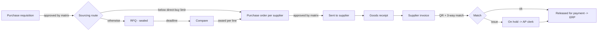

# Mawrid — Design (v2)

> v2 replaces v1 after the [design review](reviews/2026-11-design-review-v1.md). Decisions with lasting impact are recorded as [ADRs](adr/README.md). Domain terms are defined in the [glossary](GLOSSARY.md).

## 1. Context

Mid-size companies in Saudi Arabia still run a large share of their purchasing through email, WhatsApp and spreadsheets:

- An employee emails a request.
- Procurement emails three suppliers for prices.
- Quotes arrive as PDFs in different formats.
- Approvals happen in reply-all threads.
- Accounts payable (AP) finds out what was ordered only when the invoice arrives.

This causes:

- **No control:** spend is approved by whoever replies first, with no matrix and no segregation of duties.
- **No fair competition:** buyers see prices as they arrive and can leak them.
- **Slow cycle time:** nobody can tell where a request is stuck.
- **Payment errors:** invoices are paid without checking that the goods arrived, that the price matches the PO, that the VAT number is right, or that the invoice is not a duplicate.
- **Fraud exposure:** "our bank account changed" emails get paid.

Mawrid is a **buyer-side procure-to-pay platform**. Requesters, procurement, approvers, finance and suppliers work on one record, from the internal request to an invoice that is ready to pay.

## 2. Goals, non-goals and success measures

### Goals (MVP)

1. Every purchase starts from an approved requisition, and is approved by the right people according to a configurable matrix.
2. Competitive sourcing with sealed quotations and line-level award.
3. POs, goods receipts and supplier invoices are linked. Invoices are checked by three-way match and ZATCA QR validation before they are released for payment.
4. Suppliers self-onboard and keep their documents current. Bank changes are controlled.
5. Every action is auditable, and approved POs and invoices can be pushed to the customer's ERP.

### Non-goals (for now)

- Payments, or issuing invoices on a supplier's behalf (see [ADR-0006](adr/0006-buyer-side-invoice-ingestion.md)).
- Budget control or encumbrance (the cost center is captured; checking budgets comes later).
- Contracts, catalogs and punch-out.
- Multi-currency (SAR only).
- A shared supplier network across organizations.
- A frontend. The API is designed for a React client later.

### Success measures (for a pilot customer)

- **PR → PO cycle time:** median under 5 business days.
- **Spend through approved PRs:** above 90%.
- **Invoices auto-matched without manual touch:** above 70%.
- **Duplicate or wrong-VAT invoices reaching payment:** zero.

## 3. Users

| Persona | Role(s) | What they need |
|---|---|---|
| Requester (any employee) | `Requester` | Raise a PR quickly, see where it is |
| Cost center manager, director, CFO | `Approver` (scoped by policy) | Approve or reject with context, delegate when away |
| Procurement officer | `Buyer` | Turn PRs into RFQs or POs, compare sealed quotes, award, follow up deliveries |
| Storekeeper / receiver | `Receiver` | Record what actually arrived |
| AP clerk | `ApClerk` | Resolve invoices on hold, release matched invoices |
| Procurement admin | `Admin` | Users, approval policies, tolerances, supplier verification |
| Supplier contact | `SupplierUser` | Register, keep documents valid, answer RFQs, acknowledge POs, submit invoices |

## 4. Assumptions and non-functional requirements

### Volume (per organization, sized for a 500-employee company)

| Item | Volume |
|---|---|
| Active suppliers | 1,500 |
| PRs | 400 per month |
| RFQs | 150 per month (about 5 suppliers invited each) |
| POs | 1,000 per month |
| Supplier invoices | 1,500 per month, about 40% of them in the last 5 days of the month |
| Attachments | about 5 MB average; 25 MB maximum per file |

This is small, transactional load. Correctness and auditability matter far more than throughput.

### NFRs

| Area | Target |
|---|---|
| Latency | p95 below 300 ms for reads and below 600 ms for commands, excluding file upload and AI extraction |
| Availability | 99.5% monthly |
| Durability | RPO 15 minutes, RTO 4 hours (managed SQL with point-in-time restore) |
| Consistency | Strong within a command (one transaction); side effects eventually consistent through the outbox, within seconds |
| Security | TLS everywhere; tenant isolation proven by tests; OWASP ASVS L2 as the checklist |
| Data retention | No hard deletes of business records; financial records kept per ZATCA record-keeping rules; personal data handled per the PDPL |
| Localization | Arabic and English for all user-facing messages; business times in `Asia/Riyadh`; Saudi working week |
| Supportability | Every request has a correlation id; every state change has an audit row of who, when and what changed |

## 5. End-to-end flow



## 6. Modules and domain model

The app is a modular monolith ([ADR-0001](adr/0001-modular-monolith-clean-architecture.md)). Every entity carries an `OrganizationId` ([ADR-0003](adr/0003-tenant-ready-from-day-one.md)). Every aggregate root has a `RowVersion`.

### 6.1 Identity

- `Organization`, `User`, `CostCenter`.
- A user's role assignments can be **scoped**. For example, `Approver` for cost center `IT-001` only.
- Supplier users belong to exactly one `Supplier`.

### 6.2 Suppliers

**`Supplier`** (aggregate)

- Fields: `NameAr`, `NameEn`, `VatNumber`, `CrNumber`, `Status`, `Contacts`, `Documents`, `BankAccount`.
- **Status:** `Registered → UnderReview → Approved ⇄ Blocked`, or `Rejected`.

| Rule | Detail |
|---|---|
| VAT number | 15 digits, starts and ends with `3`, unique per organization |
| CR number | 10 digits |
| Required documents to approve | CR certificate, VAT certificate, bank letter. Each document has an `ExpiresOn` |
| Expired required document | Supplier becomes **not awardable**. Open POs continue. A daily job warns 30, 14 and 3 days before expiry |
| IBAN | `SA` + 22 characters, valid mod-97 checksum |
| Bank account change | A new `BankAccount` starts as `PendingVerification`. The supplier's invoices cannot be released for payment until a second Admin verifies it (four-eyes). The old account is kept in history |

### 6.3 Approvals (shared engine)

The engine is used by PRs and POs, and later by invoices that exceed tolerance.

**`ApprovalPolicy`**

- Has a document type (PR or PO) and ordered **rules**.
- A rule matches on amount band (total incl. VAT), and optionally cost center or category.
- A rule produces an ordered list of **steps**. Each step names a role and its scope (e.g. "Approver of the PR's cost center", "Finance Director", "CFO").

Example default matrix:

| Total incl. VAT (SAR) | Steps |
|---|---|
| ≤ 10,000 | Cost center manager |
| ≤ 100,000 | Cost center manager → Department director |
| > 100,000 | Cost center manager → Department director → CFO |

**`ApprovalRequest`** (aggregate)

- Created when a document is submitted, from a **snapshot** of the matching policy. A later policy edit never changes an in-flight approval.
- Steps run **in order**. A rejection at any step ends the request. A step is decided by any one eligible approver.
- **Segregation of duties:** the document's requester or creator is never eligible, even if they hold the role.
- **Delegation:** an `ApprovalDelegation(from, to, validFrom, validTo)` makes the delegate eligible. The decision records "by X on behalf of Y".
- **Concurrency:** two approvers acting on the same step get one success and one `412`.

### 6.4 Requisitions

**`PurchaseRequisition`** (aggregate)

- Fields: requester, cost center, justification, needed-by date, lines (description, quantity, unit, estimated unit price, optional preferred supplier).
- **Status:** `Draft → PendingApproval → Approved → InSourcing → Ordered`, or `Rejected` / `Cancelled`.
- **Sourcing route,** decided by the Buyer after approval:
  - **Direct PO:** allowed when the estimated total is at or below the organization's `DirectPurchaseLimit` (default 5,000 SAR).
  - **RFQ:** otherwise. Policy requires at least `MinimumSuppliersPerRfq` invitations (default 3). Fewer needs a recorded **single-source justification**.

### 6.5 Sourcing

**`Rfq`** (aggregate)

- Created from one or more approved PR lines.
- Has items, invited suppliers, a deadline, terms and attachments.
- **Status:** `Draft → Published → Closed → Awarded`, or `Cancelled`.

| Rule | Detail |
|---|---|
| Publish | At least one item; invited suppliers must be Approved and awardable; deadline at least `MinimumRfqWindow` away (default 3 business days) |
| Sealed | Prices hidden until close ([ADR-0007](adr/0007-sealed-quotations.md)) |
| Deadline | `IClock.UtcNow >= Deadline` means closed for submissions, **enforced in the domain**. The close job only updates the status and notifies |
| Amendment after publish | Suppliers who already submitted must re-confirm; deadline is extended if needed to keep the minimum window |

**`Quotation`** (aggregate)

- One per `(RfqId, SupplierId)`, enforced by a unique index.
- Has lines (unit price, VAT category, lead time in days), a validity date and attachments.
- Revisable until the deadline. Every revision is stored, and only the latest one counts.

**Award**

- Made per RFQ line, choosing one quotation line per RFQ line. Partial award is allowed: unawarded lines go back to the PR as unsourced.
- Awarding to a supplier that is not the lowest price needs a justification.
- On award: the RFQ becomes `Awarded`, a **Draft PO is created per winning supplier**, and the losing suppliers are notified through the outbox.

### 6.6 Purchasing

**`PurchaseOrder`** (aggregate)

- Fields: supplier, lines (from award or direct PR), delivery address, payment terms, totals.
- **Status:** `Draft → PendingApproval → Approved → Sent → Acknowledged → PartiallyReceived → Received → Closed`, or `Cancelled`.

| Rule | Detail |
|---|---|
| Submit | Opens an approval request from the PO policy |
| Supplier | Must still be awardable at submit time |
| Cancel | Only before any receipt |
| Close | Received in full **and** invoiced in full; or closed manually with a reason |
| Totals | Computed by the domain, line by line: VAT per line, rounded half away from zero to 2 decimals |

**`GoodsReceipt`** (aggregate)

- Lines record quantity received, quantity rejected and a reason.
- The cumulative received quantity can never exceed the ordered quantity plus an over-delivery tolerance (default 0%).

### 6.7 Payables

**`SupplierInvoice`** (aggregate)

- Fields: supplier invoice number, issue date, PO reference, lines, VAT breakdown, totals, source files (XML/PDF), decoded QR.
- **Status:** `Received → Validating → Matched | OnHold → ReleasedForPayment`, or `Rejected`.
- **Duplicate check:** unique `(OrganizationId, SupplierId, SupplierInvoiceNumber)`.
- **Validation and matching** ([ADR-0006](adr/0006-buyer-side-invoice-ingestion.md)) produce a list of `HoldReason { Code, LineRef?, Expected, Actual }`:

| Check | Fails when |
|---|---|
| `qr.missing` / `qr.malformed` | No QR or invalid TLV |
| `qr.vat_mismatch` | QR seller VAT ≠ supplier master VAT |
| `qr.total_mismatch` | QR totals ≠ invoice body totals |
| `vat.calculation` | Line VAT ≠ line net × rate, beyond 0.01 SAR per line |
| `match.price` | Invoice unit price > PO unit price beyond price tolerance (default 2% and at most 500 SAR per line) |
| `match.quantity` | Invoiced quantity (cumulative) > accepted received quantity |
| `supplier.bank_unverified` | Supplier's bank account is pending verification |

- An AP clerk resolves a hold by correcting data, requesting a credit note (later milestone), or overriding with a reason. Overrides above tolerance go through an approval.
- **VAT rates are effective-dated** (`VatRate { Category, Rate, ValidFrom }`), so historical documents compute correctly.

### 6.8 Money and time

- `Money(decimal Amount, string Currency)` is stored as `decimal(19,4)` for unit prices and `decimal(19,2)` for totals. A `double` is never used for money.
- Everything is stored in UTC. Business deadlines and SLAs are evaluated in `Asia/Riyadh` with a working-week calendar (Sunday to Thursday, configurable holidays).

## 7. Architecture

### 7.1 Layers and modules

```
src/
  Mawrid.Domain/          {Module}/  entities, value objects, domain events, errors
  Mawrid.Application/     {Module}/  commands, queries, validators, module interfaces
                          Common/    behaviors, Result, ICurrentUser, IClock, IAppDbContext
  Mawrid.Infrastructure/  {Module}/  EF configurations, integrations
                          Common/    AppDbContext, interceptors, outbox worker, storage, auth
  Mawrid.Api/             {Module}/  endpoints/controllers
                          Common/    ProblemDetails, idempotency, localization, OpenAPI
tests/
  Mawrid.Domain.Tests/  Mawrid.Application.Tests/  Mawrid.Api.Tests/  Mawrid.Architecture.Tests/
```

### 7.2 Command pipeline

Every command passes through the same MediatR behaviors, in this order:

1. **Logging & tracing:** start an activity, log the command name and correlation id.
2. **Validation:** FluentValidation; failure returns `400` with field errors.
3. **Idempotency:** if the HTTP layer supplied an `Idempotency-Key`, return the stored response on replay.
4. **Unit of work:** handler → `SaveChanges`. Within one transaction, the interceptors stamp the tenant and audit fields, write audit rows from domain events, and write outbox rows.
5. **Result mapping:** `Result<T>` → HTTP status + `ProblemDetails` with a stable `code`.

Queries skip steps 3–4. They read with `AsNoTracking()` and project straight to DTOs.

### 7.3 Side effects

These follow the transactional outbox ([ADR-0004](adr/0004-transactional-outbox.md)):

- A `BackgroundService` processes the outbox.
- **Hangfire** runs scheduled jobs: RFQ close, document expiry warnings, approval SLA reminders and outbox cleanup.
- **Consumers:** SignalR notifier, email sender (an interface; dev uses a log/file sink), ERP webhook dispatcher.

### 7.4 Integrations

| Integration | Approach |
|---|---|
| ERP (outbound) | Webhooks for `purchase_order.approved` and `supplier_invoice.released`. Signed with HMAC-SHA256 (`X-Mawrid-Signature`), retried with backoff, delivery log, manual replay. A mock receiver lives in `tools/` |
| ERP (inbound) | Cost center import by CSV upload and API |
| File storage | `IFileStorage`: Azure Blob in production, Azurite locally. Short-lived read URLs. Content-type and size allow-list. Scan status gate |
| AI extraction | `IInvoiceExtractor` behind a typed `HttpClient` with timeout, retry and a circuit breaker. Returns a typed JSON schema with a confidence per field. Output is **always** a draft for a person to confirm |

## 8. Data

Key constraints (all scoped by `OrganizationId`):

| Table | Constraint |
|---|---|
| `Suppliers` | unique `(OrganizationId, VatNumber)` |
| `Quotations` | unique `(RfqId, SupplierId)` |
| `SupplierInvoices` | unique `(OrganizationId, SupplierId, SupplierInvoiceNumber)` |
| `IdempotencyKeys` | unique `(OrganizationId, Key)`, expires after 24 h |
| `OutboxMessages` | index `(ProcessedOnUtc, OccurredOnUtc)` filtered on unprocessed |
| `AuditEntries` | append-only: entity, id, action, changes (JSON), user, on-behalf-of, timestamp, correlation id |
| All aggregate roots | `RowVersion rowversion` |

Soft delete (`IsDeleted`, `DeletedBy`, `DeletedOnUtc`) applies only to master data such as contacts and cost centers. Business documents are never deleted, only cancelled.

## 9. API conventions

- **Base:** `/api/v1`, JSON (camelCase), and an OpenAPI document with examples.
- **State changes** are explicit sub-resources: `POST /purchase-orders/{id}/submit`.
- **Concurrency:** `ETag` on reads. `If-Match` is required on `PUT`, `PATCH` and state transitions. A stale version returns `412`.
- **Idempotency:** `Idempotency-Key` header on non-idempotent POSTs.
- **Errors:** RFC 7807 `ProblemDetails` with `code`, `traceId` and `errors` (for validation). Messages are localized by `Accept-Language` (`ar`, `en`).
- **Lists:** `?page=&pageSize=&sort=` returns `{ items, page, pageSize, total }`. `pageSize` is capped at 100.
- **Buyer and supplier surfaces** are separate route groups (`/api/v1/...` and `/api/v1/supplier/...`) with separate policies.

Main endpoints:

```
Auth            POST /auth/login · /auth/refresh · /auth/logout
Requisitions    POST /requisitions · PUT /requisitions/{id} · POST /requisitions/{id}/submit
                POST /requisitions/{id}/sourcing-route
Approvals       GET /approvals/inbox · POST /approvals/{id}/approve · /reject
                POST /approval-delegations
Suppliers       GET /suppliers · POST /suppliers/{id}/approve · /block
                POST /suppliers/{id}/bank-accounts/{bankId}/verify
RFQs            POST /rfqs · PUT /rfqs/{id} · POST /rfqs/{id}/publish · /amend · /cancel
                GET /rfqs/{id}/submissions (who + when, before close)
                GET /rfqs/{id}/comparison (after close) · POST /rfqs/{id}/award
POs             GET /purchase-orders · POST /purchase-orders/{id}/submit · /send · /cancel
Receipts        POST /purchase-orders/{id}/receipts
Invoices        GET /invoices?status=OnHold · POST /invoices/{id}/resolve · /release
Supplier portal POST /supplier/register · PUT /supplier/profile · POST /supplier/documents
                GET /supplier/rfqs · PUT /supplier/rfqs/{id}/quotation
                POST /supplier/purchase-orders/{id}/acknowledge
                POST /supplier/invoices (XML/PDF upload) · POST /supplier/invoices/extract
Webhooks        CRUD /webhook-subscriptions · GET /webhook-deliveries · POST /webhook-deliveries/{id}/replay
Ops             GET /health/live · /health/ready · WS /hubs/notifications
```

## 10. Security

- **Authentication:** ASP.NET Core Identity, short-lived JWT access tokens (15 min) and refresh tokens. Refresh tokens are rotated on every use, stored hashed, and **reuse detection** revokes the whole token family. Lockout after repeated failed logins. Internal-user SSO (OIDC) is planned and has its own seam.
- **Authorization:** policies, not bare role checks. Scoped roles (e.g. approver of a cost center), resource checks (a supplier sees only its own records), and state-dependent reads (sealed quotations).
- **Tenant isolation:** global query filters plus integration tests with two organizations ([ADR-0003](adr/0003-tenant-ready-from-day-one.md)).
- **Files:** type and size allow-lists, scan gate, private containers, short-lived links.
- **Input and output:** validation on every command. No raw SQL built from input. Security headers. Rate limiting on auth and on supplier public endpoints.
- **Secrets:** user-secrets in development, Key Vault in production. Nothing secret in the repository.

## 11. Operations

| Concern | Choice |
|---|---|
| Runtime | .NET 10 LTS ([ADR-0002](adr/0002-target-dotnet-10.md)); container image (multi-stage, non-root) |
| Local dev | `docker compose up`: api, SQL Server 2022, Azurite, mock ERP receiver |
| Environments | Development · Staging · Production; config by `appsettings.{Env}.json` + environment variables + Key Vault |
| Migrations | EF Core migration bundle built in CI and run as a deploy step. Never `Database.Migrate()` at startup in production |
| Observability | Serilog (structured JSON) + OpenTelemetry traces and metrics; business metrics: PR→PO cycle time, quotations per RFQ, invoices on hold by reason |
| Health | `/health/live` (process) · `/health/ready` (SQL, storage, outbox lag below threshold) |
| CI | GitHub Actions: restore → build (warnings as errors) → tests (Testcontainers) → coverage → image build |

## 12. Testing strategy

| Level | What | Tools |
|---|---|---|
| Domain | Invariants and state machines: deadline, sealing, SoD, matching math, VAT rounding | xUnit, FluentAssertions 7 |
| Application | Handlers with a real database, so EF translation and constraints are tested | Testcontainers SQL Server |
| API | End to end through HTTP: auth, ETag/If-Match, idempotency, ProblemDetails, **two-tenant isolation** | `WebApplicationFactory` |
| Architecture | Layer and module dependency rules | NetArchTest |
| Contract | OpenAPI snapshot diffed in CI | Verify |

Test data uses builders (`ASupplier().Approved().Build()`), and `IClock` is faked everywhere time matters.

## 13. Delivery plan

The **MVP** ends at M7: one customer could run a pilot on it.

| # | Milestone | Main .NET concepts |
|---|---|---|
| M1 | Skeleton: solution, central packages, `global.json`, Docker Compose, AppDbContext, health checks, Serilog + OTel, ProblemDetails, architecture tests, CI | Hosting, DI, configuration, middleware |
| M2 | Identity & tenancy: organizations, users, scoped roles, JWT + refresh rotation, `ICurrentUser`, tenant filters, audit + outbox interceptors | Identity, auth handlers, EF interceptors, query filters |
| M3 | Suppliers: registration, documents, review, IBAN, bank-change four-eyes, file storage | Value objects, owned types, `IFileStorage`, Azurite |
| M4 | Approvals engine + requisitions | Policies, snapshotting, delegation, concurrency (`If-Match`) |
| M5 | Sourcing: RFQ, sealed quotations, amendments, line award → POs | Aggregates, unique indexes, state-dependent authorization |
| M6 | Purchasing: PO lifecycle, goods receipt, Hangfire jobs, SignalR | Background processing, real-time |
| M7 | Payables: invoice intake (UBL XML), QR TLV validation, three-way match, holds, release; ERP webhooks | XML parsing, money math, HMAC, idempotency |
| M8 | AI invoice extraction for PDF-only invoices (human-in-the-loop) | Typed `HttpClient`, resilience, structured output |
| M9 | Ops hardening: rate limiting, OpenAPI contract tests, migration bundle, load smoke test | Production readiness |

Later: budgets and encumbrance, PO change orders with re-approval, credit notes, RFQ clarification Q&A, contracts and catalogs, OIDC SSO, React frontend.

## 14. Risks and open questions

| Risk / question | Mitigation / owner |
|---|---|
| ZATCA UBL details vary between suppliers' solutions | Parse a minimal field set; collect real sample invoices; full SDK validation later |
| Approval matrix shapes differ per customer | Rules engine is data-driven; start with amount + cost center; add category when a customer needs it |
| AI extraction errors on poor scans | Confidence per field; always human-confirmed; never auto-release from AI data |
| Outbox polling load at scale | Fine at these volumes; switch to a broker (Service Bus) behind the same interface if needed |
| Open: should suppliers see their rank after award? | Default no; decide with pilot customer |
| Open: partial invoicing before full receipt? | Default allowed up to accepted quantity |

## 15. Interview talking points

- Why the deadline is enforced in the domain and not by the scheduled job.
- Sealed bids: authorization that depends on **state**, not only role.
- The approval engine: snapshotting policy, segregation of duties, delegation, concurrent approvers → `412`.
- Outbox vs dispatch after commit, and why consumers must be idempotent.
- Tolerant three-way match and effective-dated VAT.
- Why the platform **validates** ZATCA invoices instead of issuing them.
- Bank-change fraud and the four-eyes control.
- Tenant-ready from day one: query filters, the tenant inside unique indexes, two-tenant tests.
- Licensing awareness: MediatR, AutoMapper and FluentAssertions.
