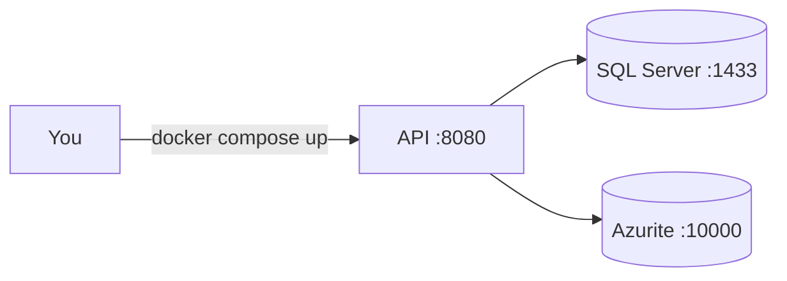

# Development guide

How to run, test and change Mawrid on your machine.

## Prerequisites

| Tool | Version |
|---|---|
| .NET SDK | 10.0 (see `global.json`) |
| Docker | Any recent version, with Docker Compose v2 |

## Run the app



**Option A — everything in Docker**

```bash
docker compose up --build
```

**Option B — dependencies in Docker, API on your machine** (faster to debug)

```bash
docker compose up -d sqlserver azurite
dotnet run --project src/Mawrid.Api
```

In Development the API applies database migrations on startup (`Database:MigrateOnStartup`).

Check that it works:

| URL | Expected |
|---|---|
| `http://localhost:8080/health/live` | `{"status":"Healthy"}` — the process is up |
| `http://localhost:8080/health/ready` | `Healthy` with a `sql-server` check — the database answers |
| `http://localhost:8080/openapi/v1.json` | The OpenAPI document (Development only) |

With `dotnet run` the port is the one shown in the console (see `launchSettings.json`).

## Run the tests

```bash
dotnet test Mawrid.slnx
```

| Project | What it tests | Needs Docker |
|---|---|---|
| `Mawrid.Domain.Tests` | Business rules, no I/O | No |
| `Mawrid.Application.Tests` | Handlers and pipeline behaviors | No |
| `Mawrid.Architecture.Tests` | Layer dependency rules | No |
| `Mawrid.Api.Tests` | Full HTTP flow against real SQL Server | **Yes** (Testcontainers) |

If your Docker cannot pull the Testcontainers helper image (`testcontainers/ryuk`), set `TESTCONTAINERS_RYUK_DISABLED=true`.

## Database migrations

Migrations live in `src/Mawrid.Infrastructure/Persistence/Migrations`. `dotnet-ef` is a local tool:

```bash
dotnet tool restore

# Add a migration after you change the model
dotnet ef migrations add <Name> -p src/Mawrid.Infrastructure -s src/Mawrid.Api -o Persistence/Migrations

# Build a migration bundle for a deploy (production never migrates on startup)
dotnet ef migrations bundle -p src/Mawrid.Infrastructure -s src/Mawrid.Api -o efbundle
```

## Configuration

| Setting | Where | Notes |
|---|---|---|
| `ConnectionStrings:Default` | `appsettings.Development.json`, or env `ConnectionStrings__Default` | Required. The app does not start without it |
| `Database:MigrateOnStartup` | Development settings | `true` locally, `false` in production |
| `Serilog:MinimumLevel` | `appsettings*.json` | Log levels |
| `OTEL_EXPORTER_OTLP_ENDPOINT` | Environment | Turns on trace and metric export |

Secrets (passwords, API keys) go in [user-secrets](https://learn.microsoft.com/aspnet/core/security/app-secrets) locally, never in a committed file:

```bash
dotnet user-secrets --project src/Mawrid.Api set "ConnectionStrings:Default" "<your connection string>"
```

## Project layout

```
src/
  Mawrid.Domain/          Business rules. No framework code.
  Mawrid.Application/     Use cases (commands, queries), validation, pipeline.
  Mawrid.Infrastructure/  EF Core, SQL Server, clock, external services.
  Mawrid.Api/             HTTP: controllers, errors, health, logging.
tests/                    One test project per layer + architecture tests.
docs/                     Design, decisions, glossary, guides.
```
