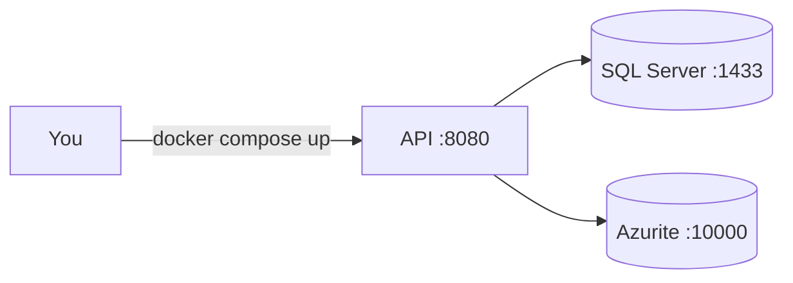

# Development guide

How to run, test and change Mawrid on your machine.

## Prerequisites

| Tool | Version |
|---|---|
| .NET SDK | 10.0 (see `global.json`) |
| Docker | Any recent version, with Docker Compose v2 |

## Run the app



**Option A — everything in Docker**

```bash
docker compose up --build
```

**Option B — dependencies in Docker, API on your machine** (faster to debug)

```bash
docker compose up -d sqlserver azurite
dotnet run --project src/Mawrid.Api
```

In Development the API applies database migrations on startup (`Database:MigrateOnStartup`).

Check that it works:

| URL | Expected |
|---|---|
| `http://localhost:8080/health/live` | `{"status":"Healthy"}` — the process is up |
| `http://localhost:8080/health/ready` | `Healthy` with a `sql-server` check — the database answers |
| `http://localhost:8080/openapi/v1.json` | The OpenAPI document (Development only) |

With `dotnet run` the port is the one shown in the console (see `launchSettings.json`).

## Demo data

In Development the app creates the organization **Acme Trading** with two cost centers (`IT-001`, `OPS-001`) and one user per role. Every demo user has the password `Mawrid-Demo-2026`.

| Email | Role |
|---|---|
| `admin@acme.test` | Admin |
| `buyer@acme.test` | Buyer |
| `approver@acme.test` | Approver for `IT-001` |
| `director@acme.test` | Approver (all cost centers) |
| `requester@acme.test` | Requester for `IT-001` |
| `receiver@acme.test` | Receiver |
| `ap@acme.test` | AP clerk |
| `cfo@acme.test` | Approver (all cost centers), CFO step |

Log in and call the API:

```bash
TOKEN=$(curl -s http://localhost:8080/api/v1/auth/login \
  -H 'Content-Type: application/json' \
  -d '{"email":"admin@acme.test","password":"Mawrid-Demo-2026"}' | jq -r .accessToken)

curl -s http://localhost:8080/api/v1/me -H "Authorization: Bearer $TOKEN"
```

In production, set `Seed:Bootstrap` (organization name, admin email and password) once to create the first organization and admin. Keep `Seed:DemoData` off.

## Background jobs and notifications

**Hangfire** runs the recurring jobs below. It keeps its tables in the `hangfire` schema of the same database. In Development, `docker compose up` is enough; the jobs are scheduled at startup.

| Job | When (Asia/Riyadh) | What it does |
|---|---|---|
| `rfqs-close-due` | Every 5 minutes | Closes RFQs past their deadline and tells the buyer |
| `suppliers-document-expiry` | Daily 06:00 | Warns when a supplier document expires in 30 or 7 days, or expired |
| `approvals-reminders` | Sunday–Thursday 08:00 | Reminds approvers about steps waiting a day or more |
| `clean-up` | Daily 03:30 | Deletes old outbox messages and expired idempotency records |

**Notifications** go out by email and SignalR. Development email is written to the log (`Email to ...`). Clients connect to `/hubs/notifications?access_token=<JWT>` and listen for `notification`:

```js
const hub = new signalR.HubConnectionBuilder()
  .withUrl("/hubs/notifications", { accessTokenFactory: () => token })
  .build();
hub.on("notification", n => console.log(n.type, n.title, n.path));
await hub.start();
```

## Try invoices and webhooks locally

`docker compose up` also starts a **mock ERP** on port 8090 (`tools/Mawrid.MockErp`). It checks webhook signatures with the secret `whsec_local-development-secret-0123456789`.

1. As `admin@acme.test`, subscribe the mock ERP:

```bash
curl -s http://localhost:8080/api/v1/webhook-subscriptions -H "Authorization: Bearer $TOKEN" \
  -H 'Content-Type: application/json' \
  -d '{"name":"Mock ERP","url":"http://mock-erp:8090/webhooks",
       "eventTypes":["purchase_order.approved","supplier_invoice.released"],
       "secret":"whsec_local-development-secret-0123456789"}'
```

2. Approve a PO or release an invoice. Within a minute the job sends the webhook. See what arrived: `curl -s http://localhost:8090/webhooks`.
3. A supplier invoice to start from is in [`docs/samples/ubl-invoice.xml`](samples/ubl-invoice.xml). Change the PO number and VAT number, upload it to `/api/v1/files` as `application/xml`, then post `{"xmlFileId": "<id>"}` to `/api/v1/supplier/invoices`.

## AI invoice extraction

`POST /api/v1/invoices/extract` with `{"pdfFileId": "...", "purchaseOrderId": "..."}` returns a draft with a confidence per value. It works out of the box with **Pollinations** (free, no account). Use made-up invoices only: it is a public service.

- **Local model (Ollama):** `docker compose --profile ai up`, then `docker compose exec ollama ollama pull qwen2.5:3b`, and set `AiExtraction__Provider=Ollama` and `AiExtraction__BaseUrl=http://ollama:11434/v1` for the API.
- **OpenAI:** `dotnet user-secrets --project src/Mawrid.Api set "AiExtraction:ApiKey" "<key>"` and set `AiExtraction:Provider` to `OpenAI`.
- The tests use a fake provider. To try the prompt against a real one: `MAWRID_LIVE_AI=Pollinations dotnet test --filter LiveExtraction`.

## Run the tests

```bash
dotnet test Mawrid.slnx
```

| Project | What it tests | Needs Docker |
|---|---|---|
| `Mawrid.Domain.Tests` | Business rules, no I/O | No |
| `Mawrid.Application.Tests` | Handlers and pipeline behaviors | No |
| `Mawrid.Architecture.Tests` | Layer dependency rules | No |
| `Mawrid.Api.Tests` | Full HTTP flow against real SQL Server | **Yes** (Testcontainers) |

If your Docker cannot pull the Testcontainers helper image (`testcontainers/ryuk`), set `TESTCONTAINERS_RYUK_DISABLED=true`.

**API contract.** `OpenApiContractTests` compares `/openapi/v1.json` with `tests/Mawrid.Api.Tests/Contract/openapi.v1.json`. When you change an endpoint or a DTO on purpose, accept the new contract and commit it:

```bash
UPDATE_SNAPSHOTS=1 dotnet test tests/Mawrid.Api.Tests --filter OpenApiContract
```

**Load smoke test.** With the app running (`docker compose up`):

```bash
dotnet run --project tools/Mawrid.LoadSmoke -- http://localhost:8080 20 30 500   # users, seconds, p95 limit in ms
```

It logs in as the demo buyer, reads lists with 20 parallel users and fails if p95 is over the limit or more than 1% of requests fail.

## Database migrations

Migrations live in `src/Mawrid.Infrastructure/Persistence/Migrations`. `dotnet-ef` is a local tool:

```bash
dotnet tool restore

# Add a migration after you change the model
dotnet ef migrations add <Name> -p src/Mawrid.Infrastructure -s src/Mawrid.Api -o Persistence/Migrations

# Build a migration bundle for a deploy (production never migrates on startup)
dotnet ef migrations bundle -p src/Mawrid.Infrastructure -s src/Mawrid.Api -o efbundle
```

## Configuration

| Setting | Where | Notes |
|---|---|---|
| `ConnectionStrings:Default` | `appsettings.Development.json`, or env `ConnectionStrings__Default` | Required. The app does not start without it |
| `Database:MigrateOnStartup` | Development settings | `true` locally, `false` in production |
| `Serilog:MinimumLevel` | `appsettings*.json` | Log levels |
| `Jwt:SigningKey` | Secrets | Required. At least 32 characters |
| `Jwt:AccessTokenMinutes`, `Jwt:RefreshTokenDays` | Settings | Defaults: 15 minutes, 14 days |
| `Outbox:PollingInterval`, `Outbox:BatchSize`, `Outbox:MaxAttempts` | Settings | Defaults: 2 seconds, 20, 8 |
| `Webhooks:AllowHttp` | Settings | Allows `http://` webhook URLs. `true` only in Development (for the mock ERP) |
| `Webhooks:Timeout` | Settings | How long one webhook call may take. Default 10 seconds |
| `AiExtraction:Provider` | Settings | `Pollinations` (default, free, no key), `Ollama` or `OpenAI` |
| `AiExtraction:BaseUrl`, `AiExtraction:Model` | Settings | Override the provider's URL and model |
| `AiExtraction:ApiKey` | Secrets | Only for OpenAI |
| `RateLimits:LoginPerMinute`, `RateLimits:SupplierPerMinute`, `RateLimits:AiExtractionPerMinute` | Settings | Defaults: 10, 120, 10. Tests raise them |
| `Jobs:Enabled` | Settings | Runs the Hangfire server and its recurring jobs. Default `true`; tests set `false` |
| `Jobs:OutboxRetention` | Settings | How long processed outbox messages are kept. Default 7 days |
| `Seed:Bootstrap`, `Seed:DemoData` | Settings | First organization and admin; demo data (Development only) |
| `OTEL_EXPORTER_OTLP_ENDPOINT` | Environment | Turns on trace and metric export |

Secrets (passwords, API keys) go in [user-secrets](https://learn.microsoft.com/aspnet/core/security/app-secrets) locally, never in a committed file:

```bash
dotnet user-secrets --project src/Mawrid.Api set "ConnectionStrings:Default" "<your connection string>"
```

## Project layout

```
src/
  Mawrid.Domain/          Business rules. No framework code.
  Mawrid.Application/     Use cases (commands, queries), validation, pipeline.
  Mawrid.Infrastructure/  EF Core, SQL Server, clock, external services.
  Mawrid.Api/             HTTP: controllers, errors, health, logging.
tests/                    One test project per layer + architecture tests.
docs/                     Design, decisions, glossary, guides.
```
