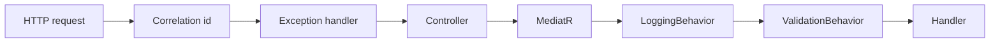
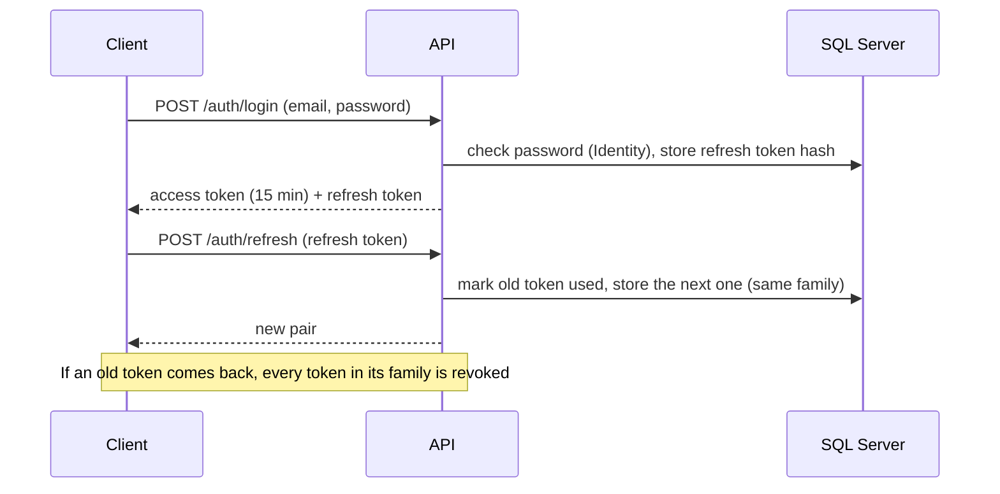
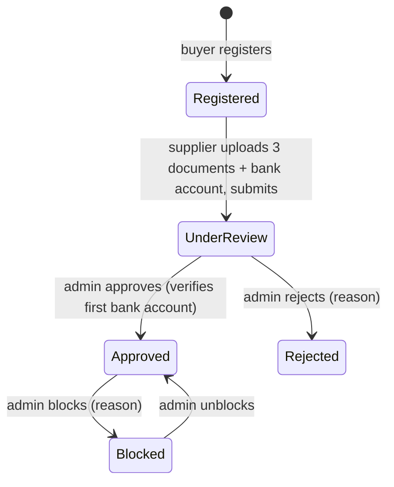
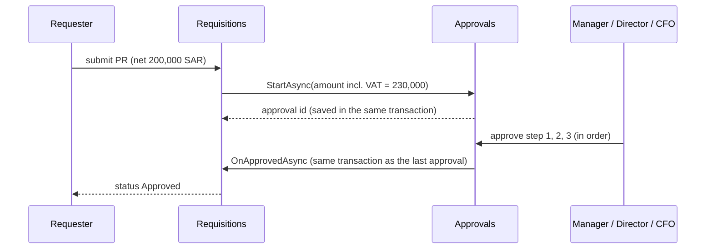
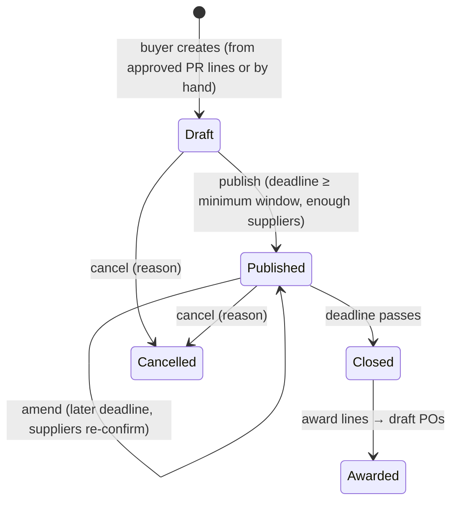
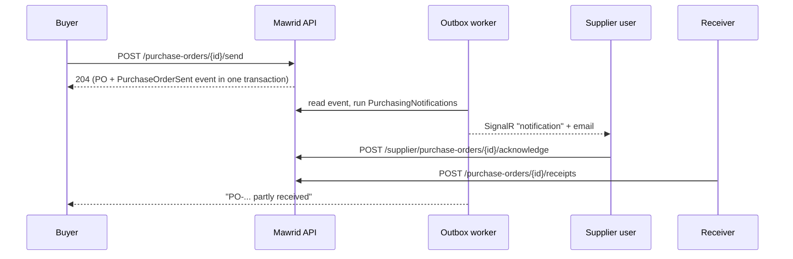

# Learning notes: NestJS → ASP.NET Core

My notes while building Mawrid. I come from Node.js, NestJS and TypeScript. Most ideas map one-to-one to .NET. The differences are where the learning is.

## Concept map

| NestJS / Node | ASP.NET Core / .NET | Notes |
|---|---|---|
| `package.json` / npm | `.csproj` + NuGet (`dotnet add package`) | A solution (`.sln`) groups several projects, like a monorepo with workspaces |
| `main.ts` bootstrap | `Program.cs` (minimal hosting) | `builder.Services...` = providers, `app.Use...` = middleware |
| `@Module({ providers })` | `IServiceCollection` extension methods (`AddApplication()`, `AddInfrastructure()`) | No module decorators. Each layer has one `Add*` method |
| `@Injectable()` + constructor injection | Constructor injection, registered as `AddScoped/AddTransient/AddSingleton` | Scoped = one instance per HTTP request. It is cheap, and it is the default for DbContext |
| `@Controller()` / `@Get()` | `[ApiController]` + `[HttpGet]` | Model binding does the work of `@Body()`, `@Param()` and `@Query()` |
| `class-validator` DTOs + `ValidationPipe` | FluentValidation + MediatR pipeline behavior | Rules live in a validator class, not as decorators on the DTO |
| Interceptors | Middleware, filters, MediatR `IPipelineBehavior` | Pipeline behaviors run around every command: validation, logging, transactions |
| Exception filters | `IExceptionHandler` + `ProblemDetails` (RFC 7807) | A standard error format, built in |
| Guards | Authorization policies + `IAuthorizationHandler` | `[Authorize(Policy = "...")]` |
| Prisma / TypeORM | EF Core | `DbContext` ≈ Prisma client. `IEntityTypeConfiguration<T>` ≈ schema. Migrations are C# files |
| Prisma `$transaction` | `SaveChanges()` is already one transaction; `BeginTransactionAsync` for more | The change tracker saves all changes together |
| `@nestjs/config` + `.env` | `appsettings.json` + env vars + `IOptions<T>` | The env var `ConnectionStrings__Default` overrides `ConnectionStrings:Default` in the JSON file |
| BullMQ | Hangfire / `BackgroundService` | Hangfire gives a dashboard, retries and cron, like Bull |
| `@nestjs/websockets` / Socket.IO | SignalR | Groups ≈ rooms |
| Jest | xUnit + FluentAssertions + NSubstitute | `[Fact]` = `it`, `[Theory]` + `[InlineData]` = `it.each` |
| Supertest e2e | `WebApplicationFactory<Program>` | Starts the real app in memory |
| `interface` (structural) | `interface` (nominal) | A class must declare `: IFoo`. Having the same shape is not enough |
| `string \| null` | `string?` with nullable reference types on | The compiler warns about possible nulls. We treat warnings as errors |
| `Promise<T>` / `async` | `Task<T>` / `async` | Pass a `CancellationToken` all the way down. Similar to `AbortSignal`, but every async API in .NET accepts one |
| `number` | `int`, `long`, `decimal`, `double` | **Money is always `decimal`** |
| `readonly` class / `as const` | `record`, `init` setters | Records compare by value. Good for value objects and DTOs |

## Milestone notes

Each milestone adds a section here: what we built, the .NET idea behind it, and the questions an interviewer will probably ask.

### M1 — Skeleton

**What we built:** the solution layout, shared build settings, the request pipeline, the error contract, health checks, logging, telemetry, Docker and CI.

| .NET idea | Where | NestJS equivalent |
|---|---|---|
| `Directory.Build.props` | Repo root | A shared `tsconfig` base that every project extends |
| Central package management (`Directory.Packages.props`) | Repo root | One `package.json` with pinned versions for the whole monorepo |
| `IServiceCollection` extension methods | `AddApplication()`, `AddInfrastructure()` | A module's `providers` array |
| Middleware order | `Program.cs` | `app.use(...)` order |
| `IExceptionHandler` + `ProblemDetails` | `GlobalExceptionHandler` | A global exception filter |
| `IPipelineBehavior` | `LoggingBehavior`, `ValidationBehavior` | Interceptors around every handler |
| `[LoggerMessage]` source-generated logging | Behaviors, exception handler | No real equivalent; it generates fast, typed log methods at compile time |
| Health checks | `HealthSetup` | `@nestjs/terminus` |
| `WebApplicationFactory<Program>` | `Mawrid.Api.Tests` | `Test.createTestingModule` + supertest |
| Testcontainers | `MawridApiFactory` | Same library exists for Node |

**Decisions worth explaining**

- **Validation errors are exceptions; business failures are `Result`.** Bad input is the caller's bug and the request cannot even start, so the pipeline stops it early and returns 400. "The deadline has passed" is a normal business outcome, so the handler returns it as a value with a stable code.
- **Liveness vs readiness.** If the database is down, restarting the app does not help. So `/health/live` checks nothing, and only `/health/ready` checks SQL Server. The orchestrator stops sending traffic but does not kill the container.
- **The correlation id is validated.** We accept only short ids of letters, digits, `-` and `_`. Anything else is replaced, so a caller cannot inject text into our logs.
- **Migrations on startup only in Development and tests.** In production, several instances starting at once could all try to migrate. A migration bundle runs once, as a deploy step.

**Likely interview questions**

1. What is the difference between `AddScoped`, `AddTransient` and `AddSingleton`? Why is `DbContext` scoped?
2. Why does the order of middleware matter? What happens if `UseExceptionHandler` comes after the controllers?
3. How do you test an ASP.NET Core API end to end without mocking the database?
4. What is the difference between liveness and readiness probes?
5. Why use central package management in a multi-project solution?

### M2 — Identity, tenancy, audit and outbox

**What we built:** login with JWT and rotating refresh tokens, users and cost centers, a tenant filter on every query, audit rows, and a transactional outbox.

| .NET idea | Where | NestJS equivalent |
|---|---|---|
| ASP.NET Core Identity (`UserManager`) | `IdentityService` | Passport local strategy + bcrypt, written by hand |
| JWT bearer authentication | `AuthenticationSetup` | `@nestjs/jwt` + `JwtAuthGuard` |
| Fallback authorization policy | `Policies.Configure` | A global guard |
| Policies (`RequireRole`, `RequireAssertion`) | `Policies` | Role guards with `@Roles()` |
| EF Core named query filters (new in EF 10) | `AppDbContext` | Prisma middleware that adds `where: { orgId }` |
| `SaveChangesInterceptor` | `AuditingInterceptor`, `OutboxInterceptor` | Prisma `$extends` query hooks |
| `BackgroundService` + `PeriodicTimer` | `OutboxWorker` | A BullMQ repeatable job |
| `IOptions<T>` + `ValidateOnStart` | `JwtOptions`, `OutboxOptions` | `ConfigModule` with a Joi schema |

**Decisions worth explaining**

- **Two user records.** `User` (Domain) holds business data: roles and organization. `UserCredential` (Identity) holds the password hash and lockout. They share one id. The domain stays free of framework code.
- **Refresh token rotation with reuse detection.** A refresh token works once. If a used token comes back, someone copied it, so we revoke the whole family. `UsedAtUtc` is a concurrency token, so two requests with the same token at the same moment cannot both win.
- **Tenant from the token only.** The organization id comes from the `org` claim, never from the URL or body. Without a token, `OrganizationId` is null and tenant queries return nothing: the safe default.
- **Audit from the change tracker.** One row per changed record, in the same transaction, with old and new values. Secrets (hashes, stamps) are never written. Enums are written by name.
- **Outbox claim with `READPAST`.** One `UPDATE` picks the oldest due messages and locks them for 5 minutes. A second worker skips locked rows instead of waiting. Delivery is at-least-once, so handlers must be idempotent.

**Likely interview questions**

1. Why short access tokens plus refresh tokens instead of one long token?
2. How do you detect a stolen refresh token?
3. How do you make sure one tenant never sees another tenant's data? What is the risk of `IgnoreQueryFilters`?
4. What problem does the outbox pattern solve? Why not publish the event right after `SaveChanges`?
5. How do two outbox workers avoid sending the same message twice?
6. Why does login for an unknown email still hash a password?

### M3 — Suppliers, files and idempotency

**What we built:** supplier onboarding with documents and a four-eyes bank account rule, file upload to blob storage with safety checks, and `Idempotency-Key` support.

| .NET idea | Where | NestJS equivalent |
|---|---|---|
| Value objects as `record` + EF value converters | `VatNumber`, `CrNumber`, `Iban` | A class with a static `create()` and a TypeORM transformer |
| `OwnsMany` (owned collections) | Supplier documents and bank accounts | A one-to-many relation with cascade |
| `ComplexProperty` (EF 8+) | Supplier contact stored as columns | An embedded entity (`@Column(() => Contact)`) |
| `IFormFile` + `[RequestSizeLimit]` | `FilesController` | `@UseInterceptors(FileInterceptor())` with limits |
| Middleware reading endpoint metadata | `IdempotencyMiddleware` + `[Idempotent]` | An interceptor that reads `Reflector` metadata |
| Testcontainers for Azurite | `MawridApiFactory` | Same, with the Node library |

**Decisions worth explaining**

- **Invited onboarding, not public sign-up.** Procurement registers the supplier and invites its contact. A public sign-up page would need a way to pick the right buyer organization, and invites are how buyers work with suppliers in practice.
- **Magic bytes, not file extensions.** We check the first bytes of the file against the declared type. A renamed `.exe` cannot pass as a PDF.
- **Scanner behind an interface.** Development uses an EICAR test-string detector. Production plugs in a real scanner without code changes.
- **Contracts between modules.** Identity needs to know if a supplier exists. It asks `ISupplierDirectory` in `Mawrid.Application.Contracts.Suppliers`; an architecture test fails the build if a module reaches into another module's entities.
- **Idempotency records in their own scope.** The middleware saves records through a separate `DbContext`, so a failed request never leaves half-saved changes behind.

**Likely interview questions**

1. What is a value object? How do you store one with EF Core?
2. How do you make a POST endpoint safe to retry?
3. What is the four-eyes principle, and where does it matter in finance?
4. How do you validate an uploaded file safely?
5. How do modules in a modular monolith talk to each other without coupling?

### M4 — Approval engine and requisitions

**What we built:** a data-driven approval matrix, approver groups, delegation, and purchase requisitions that go through it.

| .NET idea | Where | NestJS equivalent |
|---|---|---|
| Primitive collections (`List<Guid>` as JSON) | `ApproverGroup.MemberUserIds`, `ApprovalStep.EligibleApproverIds` | A `jsonb` column in Prisma |
| Value converter to a JSON column | `ApprovalPolicy` rules | `@Column({ type: 'json' })` |
| `ComplexProperty` | `Organization.Settings` | An embedded entity |
| Raw SQL with `SqlQuery<T>` | `DocumentNumbers` (`MERGE ... HOLDLOCK`) | `prisma.$queryRaw` |
| `IEnumerable<T>` injection (all implementations) | `IApprovalDocumentHandler` | Injecting a multi-provider token |
| ETag / If-Match | `ApprovalsController`, `ETags` | Writing the headers by hand |

**Decisions worth explaining**

- **Copy the rule at start.** The request stores the steps and the eligible approvers when it starts. If an admin changes the matrix tomorrow, approvals already in progress do not change under people's feet.
- **The document module decides what "approved" means.** Approvals knows nothing about requisitions. Each document module implements `IApprovalDocumentHandler`; the last approval calls it in the same transaction, so the requisition and the approval never disagree.
- **Two kinds of concurrency protection.** The `RowVersion` stops two simultaneous decisions (409). `If-Match` stops a decision based on an old screen (412).
- **Document numbers from one `MERGE`.** `HOLDLOCK` makes the read-and-increment atomic, so two requests never get the same number. A failed save leaves a gap; that is fine for internal documents.

**Likely interview questions**

1. How would you design a configurable approval workflow?
2. What is segregation of duties, and how do you enforce it in code?
3. Difference between optimistic and pessimistic concurrency? When does each fit?
4. How do you generate gap-free or unique sequential numbers in SQL Server?
5. How do two modules stay consistent without calling each other's database tables?

### M5 — Sourcing (RFQs and sealed quotations)

**What we built:** RFQs sent to invited suppliers, sealed quotations that the buyer cannot see before the deadline, a price comparison, and an award that creates one draft purchase order per winning supplier.

| .NET idea | Where | NestJS equivalent |
|---|---|---|
| Injected clock (`IClock`) + `TestClock` | Deadlines, "sealed" checks | Injecting a `Clock` provider and faking it with `jest.useFakeTimers()` |
| Owned entities with their own `Id` key | `RfqInvitation`, `RfqAward`, `QuotationLine` | Child tables with a UUID primary key |
| Unique index on owned rows | One invitation per (RFQ, supplier) | `@@unique([rfqId, supplierId])` in Prisma |
| One `SaveChangesAsync` across modules | Award saves RFQ, POs and PRs together | One `prisma.$transaction([...])` |

**Decisions worth explaining**

- **The deadline is checked by the clock, not by the status column.** An RFQ stays `Published` until something closes it. Quotation submit and the buyer's comparison both ask `IsOpen(now)` / `IsSealed(now)`, so a late quotation is refused even if the close job has not run yet.
- **Sealed means sealed.** The buyer API returns no prices until the deadline passes. The first time a buyer opens the quotations, we record who and when.
- **Amend forces re-confirmation.** Changing quantities raises the RFQ revision. A quotation for an older revision is not eligible until the supplier submits again.
- **Award needs a reason for a non-lowest price.** The handler works out the lowest eligible price per line. Picking another supplier without a 10-character justification fails with `422`.
- **Owned items need their own key.** We first keyed `RfqInvitation` by (RFQ id, supplier id). EF Core saw a new invitation with a known key, treated it as an existing row and sent an `UPDATE` that changed 0 rows, which surfaced as a `409`. A separate `Guid Id` fixed it. Lesson: a client-set key on a child row means "this row already exists" to EF.

**Likely interview questions**

1. How do you test code that depends on the current time?
2. How would you hide bids from buyers until a deadline, and prove it?
3. How do you keep several aggregates consistent in one request?
4. Why can EF Core send an `UPDATE` for a row you meant to insert?
5. What audit trail does a public-sector-style tender need?

### M6 — Purchasing, notifications and background jobs

**What we built:** the purchase order life cycle (approval, send, supplier acknowledgement, goods receipts, close), direct purchases for small requisitions, email and SignalR notifications from outbox events, and Hangfire jobs.

| .NET idea | Where | NestJS equivalent |
|---|---|---|
| SignalR hub + `IHubContext<T>` | `NotificationsHub`, `SignalRNotificationChannel` | `@WebSocketGateway()` with Socket.IO |
| `IUserIdProvider` | Hub addresses users by the JWT `sub` claim | Socket.IO rooms named by user id |
| Hangfire recurring jobs | `MawridJobs`, `RecurringJobSchedule` | `@nestjs/schedule` cron, or BullMQ repeatable jobs |
| `BackgroundService` with retry | `RecurringJobRegistration` | A provider with `onApplicationBootstrap` and a retry loop |
| `IEnumerable<INotificationChannel>` | Email + SignalR, one interface | Injecting an array of providers under one token |
| `INotificationHandler<T>` per module | `PurchasingNotifications`, `SourcingNotifications` | `@OnEvent()` listeners |

**Decisions worth explaining**

- **Notifications come from the outbox, not from the request.** The handler saves the PO and the event together. The notification is sent later by the worker, so an email is never sent for a change that rolled back, and a slow mail server never slows the API.
- **Notifications are best effort.** If SignalR or email fails, the sender logs it and goes on. The business change is already saved; a missed email must not retry the whole event.
- **Jobs run once per organization, as the system.** The runner opens a scope per organization and calls `RunAsSystem(orgId)`. The tenant filter works exactly as in a request, so job code has no special "all tenants" queries. Commands check `IsSystem`, so a person cannot call them.
- **No automatic retries for jobs.** Each job runs again on its next schedule. A retry could send the same reminder twice.
- **The app starts even when SQL Server is down.** Jobs are scheduled from a background service that retries, so `/health/live` stays green and `/health/ready` reports the problem.
- **The buyer cannot receive their own order.** Placing an order and confirming its delivery are separate duties, like requesting and approving. It protects the three-way match in M7.
- **Short close.** A supplier sometimes cannot deliver the rest. The buyer closes a partly received PO with a reason instead of cancelling it.

**Likely interview questions**

1. How do you send real-time updates to one user in ASP.NET Core?
2. Why send notifications from an outbox instead of directly from the API call?
3. How do recurring jobs work in a multi-tenant system without leaking data?
4. What happens to your app when the database is down at startup?
5. Hangfire vs a `BackgroundService` vs a message broker: when do you pick each?
