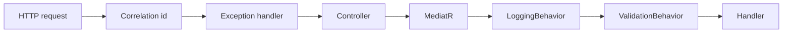
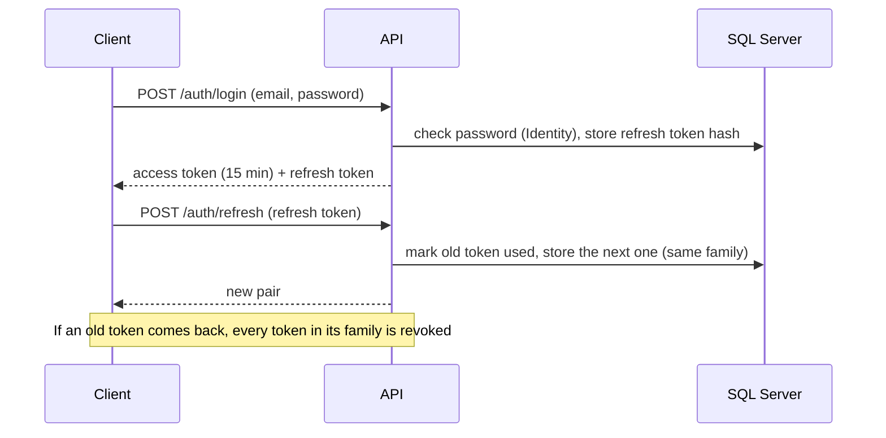

# Learning notes: NestJS → ASP.NET Core

My notes while building Mawrid. I come from Node.js, NestJS and TypeScript. Most ideas map one-to-one to .NET. The differences are where the learning is.

## Concept map

| NestJS / Node | ASP.NET Core / .NET | Notes |
|---|---|---|
| `package.json` / npm | `.csproj` + NuGet (`dotnet add package`) | A solution (`.sln`) groups several projects, like a monorepo with workspaces |
| `main.ts` bootstrap | `Program.cs` (minimal hosting) | `builder.Services...` = providers, `app.Use...` = middleware |
| `@Module({ providers })` | `IServiceCollection` extension methods (`AddApplication()`, `AddInfrastructure()`) | No module decorators. Each layer has one `Add*` method |
| `@Injectable()` + constructor injection | Constructor injection, registered as `AddScoped/AddTransient/AddSingleton` | Scoped = one instance per HTTP request. It is cheap, and it is the default for DbContext |
| `@Controller()` / `@Get()` | `[ApiController]` + `[HttpGet]` | Model binding does the work of `@Body()`, `@Param()` and `@Query()` |
| `class-validator` DTOs + `ValidationPipe` | FluentValidation + MediatR pipeline behavior | Rules live in a validator class, not as decorators on the DTO |
| Interceptors | Middleware, filters, MediatR `IPipelineBehavior` | Pipeline behaviors run around every command: validation, logging, transactions |
| Exception filters | `IExceptionHandler` + `ProblemDetails` (RFC 7807) | A standard error format, built in |
| Guards | Authorization policies + `IAuthorizationHandler` | `[Authorize(Policy = "...")]` |
| Prisma / TypeORM | EF Core | `DbContext` ≈ Prisma client. `IEntityTypeConfiguration<T>` ≈ schema. Migrations are C# files |
| Prisma `$transaction` | `SaveChanges()` is already one transaction; `BeginTransactionAsync` for more | The change tracker saves all changes together |
| `@nestjs/config` + `.env` | `appsettings.json` + env vars + `IOptions<T>` | The env var `ConnectionStrings__Default` overrides `ConnectionStrings:Default` in the JSON file |
| BullMQ | Hangfire / `BackgroundService` | Hangfire gives a dashboard, retries and cron, like Bull |
| `@nestjs/websockets` / Socket.IO | SignalR | Groups ≈ rooms |
| Jest | xUnit + FluentAssertions + NSubstitute | `[Fact]` = `it`, `[Theory]` + `[InlineData]` = `it.each` |
| Supertest e2e | `WebApplicationFactory<Program>` | Starts the real app in memory |
| `interface` (structural) | `interface` (nominal) | A class must declare `: IFoo`. Having the same shape is not enough |
| `string \| null` | `string?` with nullable reference types on | The compiler warns about possible nulls. We treat warnings as errors |
| `Promise<T>` / `async` | `Task<T>` / `async` | Pass a `CancellationToken` all the way down. Similar to `AbortSignal`, but every async API in .NET accepts one |
| `number` | `int`, `long`, `decimal`, `double` | **Money is always `decimal`** |
| `readonly` class / `as const` | `record`, `init` setters | Records compare by value. Good for value objects and DTOs |

## Milestone notes

Each milestone adds a section here: what we built, the .NET idea behind it, and the questions an interviewer will probably ask.

### M1 — Skeleton

**What we built:** the solution layout, shared build settings, the request pipeline, the error contract, health checks, logging, telemetry, Docker and CI.

| .NET idea | Where | NestJS equivalent |
|---|---|---|
| `Directory.Build.props` | Repo root | A shared `tsconfig` base that every project extends |
| Central package management (`Directory.Packages.props`) | Repo root | One `package.json` with pinned versions for the whole monorepo |
| `IServiceCollection` extension methods | `AddApplication()`, `AddInfrastructure()` | A module's `providers` array |
| Middleware order | `Program.cs` | `app.use(...)` order |
| `IExceptionHandler` + `ProblemDetails` | `GlobalExceptionHandler` | A global exception filter |
| `IPipelineBehavior` | `LoggingBehavior`, `ValidationBehavior` | Interceptors around every handler |
| `[LoggerMessage]` source-generated logging | Behaviors, exception handler | No real equivalent; it generates fast, typed log methods at compile time |
| Health checks | `HealthSetup` | `@nestjs/terminus` |
| `WebApplicationFactory<Program>` | `Mawrid.Api.Tests` | `Test.createTestingModule` + supertest |
| Testcontainers | `MawridApiFactory` | Same library exists for Node |

**Decisions worth explaining**

- **Validation errors are exceptions; business failures are `Result`.** Bad input is the caller's bug and the request cannot even start, so the pipeline stops it early and returns 400. "The deadline has passed" is a normal business outcome, so the handler returns it as a value with a stable code.
- **Liveness vs readiness.** If the database is down, restarting the app does not help. So `/health/live` checks nothing, and only `/health/ready` checks SQL Server. The orchestrator stops sending traffic but does not kill the container.
- **The correlation id is validated.** We accept only short ids of letters, digits, `-` and `_`. Anything else is replaced, so a caller cannot inject text into our logs.
- **Migrations on startup only in Development and tests.** In production, several instances starting at once could all try to migrate. A migration bundle runs once, as a deploy step.

**Likely interview questions**

1. What is the difference between `AddScoped`, `AddTransient` and `AddSingleton`? Why is `DbContext` scoped?
2. Why does the order of middleware matter? What happens if `UseExceptionHandler` comes after the controllers?
3. How do you test an ASP.NET Core API end to end without mocking the database?
4. What is the difference between liveness and readiness probes?
5. Why use central package management in a multi-project solution?

### M2 — Identity, tenancy, audit and outbox

**What we built:** login with JWT and rotating refresh tokens, users and cost centers, a tenant filter on every query, audit rows, and a transactional outbox.

| .NET idea | Where | NestJS equivalent |
|---|---|---|
| ASP.NET Core Identity (`UserManager`) | `IdentityService` | Passport local strategy + bcrypt, written by hand |
| JWT bearer authentication | `AuthenticationSetup` | `@nestjs/jwt` + `JwtAuthGuard` |
| Fallback authorization policy | `Policies.Configure` | A global guard |
| Policies (`RequireRole`, `RequireAssertion`) | `Policies` | Role guards with `@Roles()` |
| EF Core named query filters (new in EF 10) | `AppDbContext` | Prisma middleware that adds `where: { orgId }` |
| `SaveChangesInterceptor` | `AuditingInterceptor`, `OutboxInterceptor` | Prisma `$extends` query hooks |
| `BackgroundService` + `PeriodicTimer` | `OutboxWorker` | A BullMQ repeatable job |
| `IOptions<T>` + `ValidateOnStart` | `JwtOptions`, `OutboxOptions` | `ConfigModule` with a Joi schema |

**Decisions worth explaining**

- **Two user records.** `User` (Domain) holds business data: roles and organization. `UserCredential` (Identity) holds the password hash and lockout. They share one id. The domain stays free of framework code.
- **Refresh token rotation with reuse detection.** A refresh token works once. If a used token comes back, someone copied it, so we revoke the whole family. `UsedAtUtc` is a concurrency token, so two requests with the same token at the same moment cannot both win.
- **Tenant from the token only.** The organization id comes from the `org` claim, never from the URL or body. Without a token, `OrganizationId` is null and tenant queries return nothing: the safe default.
- **Audit from the change tracker.** One row per changed record, in the same transaction, with old and new values. Secrets (hashes, stamps) are never written. Enums are written by name.
- **Outbox claim with `READPAST`.** One `UPDATE` picks the oldest due messages and locks them for 5 minutes. A second worker skips locked rows instead of waiting. Delivery is at-least-once, so handlers must be idempotent.

**Likely interview questions**

1. Why short access tokens plus refresh tokens instead of one long token?
2. How do you detect a stolen refresh token?
3. How do you make sure one tenant never sees another tenant's data? What is the risk of `IgnoreQueryFilters`?
4. What problem does the outbox pattern solve? Why not publish the event right after `SaveChanges`?
5. How do two outbox workers avoid sending the same message twice?
6. Why does login for an unknown email still hash a password?
