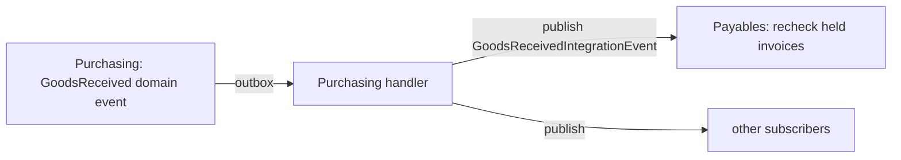

# 0010. Integration events between modules

- Status: Accepted
- Date: 2026-11-10

## Context

Some modules must react to what happens in another module. Payables must check a held invoice again when Purchasing records a goods receipt. The webhook sender must hear about approved POs and released invoices.

A module's domain events are internal: they name its entities and can change at any time. ADR-0001 and the architecture tests forbid one module from using another module's domain types.

## Decision

The module that owns the event publishes a small **integration event** from its outbox handler:

- Integration events are records in `Mawrid.Application.Contracts.{Module}`, next to the module's other published interfaces.
- They carry ids and the plain data subscribers need, never entities.
- They are published in-process (MediatR) while the outbox delivers the domain event, so they inherit the outbox guarantees: at least once, after the transaction committed.

## Consequences

- Modules stay independent: the architecture tests still pass, and Payables does not know Purchasing's entities.
- Handlers must be safe to run twice (a recheck is; a notification may be sent twice).
- If a module moves to its own service later, the integration events become messages on a broker with the same shape.
